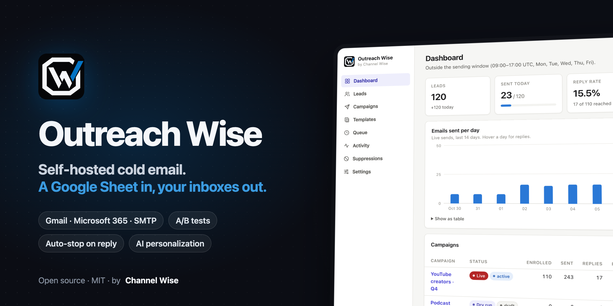
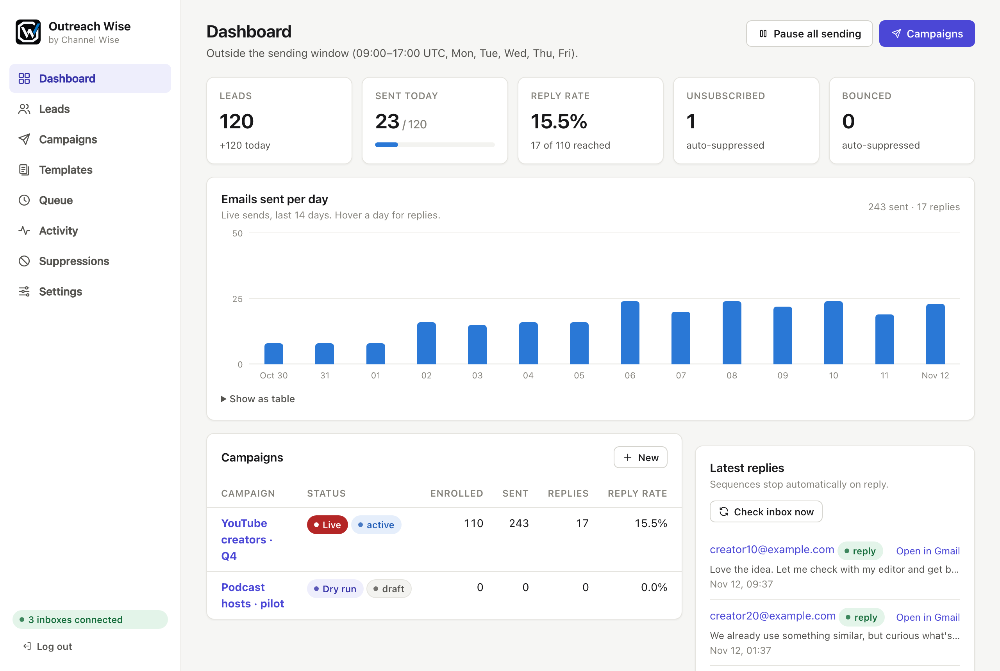
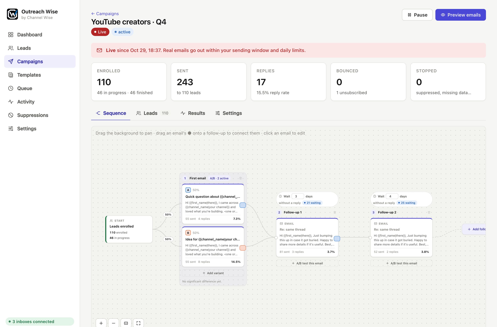
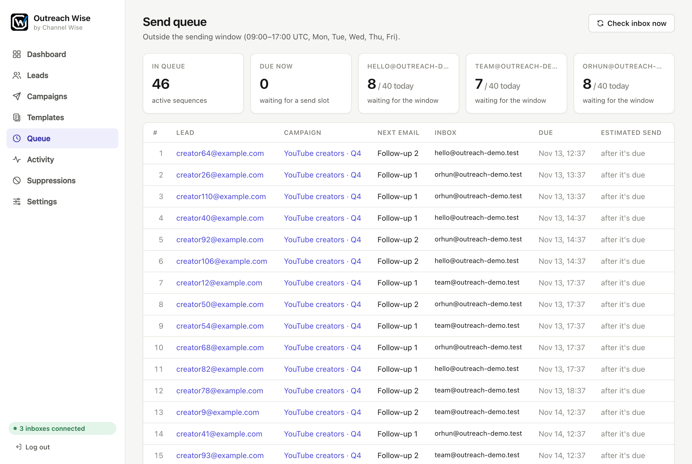
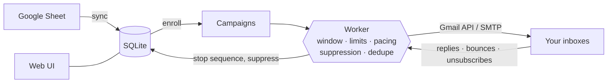

<div align="center">

<a href="https://github.com/Channel-Wise/outreach-wise"></a>

<br>

[](https://github.com/Channel-Wise/outreach-wise/actions/workflows/ci.yml)
[](LICENSE)
[](pyproject.toml)
[](docker-compose.yml)


**[Quick start](#quick-start)** · [Connect inboxes](#connect-your-inboxes) · [Lead sheet](#your-lead-sheet) · [Campaigns](#writing-campaigns) · [AI](#ai-personalization-optional) · [Safety](#safety-model) · [Deploy](#deployment)

</div>

<br>

Outreach Wise reads leads from a Google Sheet and sends personalized multi-step sequences from
your own Gmail, Google Workspace, Microsoft 365 or SMTP/IMAP inboxes. It stops following up as
soon as someone replies, and its dashboard shows what is working. It runs as **one Python
process with one SQLite file**: no subscription, and your leads stay on your server.

We built it for Channel Wise's outreach to YouTube creators: thousands of leads in a sheet and a
few hundred new ones a day. It doesn't depend on any Channel Wise infrastructure, so anyone can
self-host it.

## Why Outreach Wise

<table>
<tr>
<td width="33%" valign="top">

### 🏠 Yours
Self-hosted and MIT licensed, with no per-seat pricing. Back up one SQLite file and you have all
your data.

</td>
<td width="33%" valign="top">

### 📬 Real inboxes
Sends from the mailboxes you already have and threads follow-ups in the same conversation. No
delivery infrastructure of its own.

</td>
<td width="33%" valign="top">

### 🛑 Stops itself
Replies, bounces and unsubscribes end the sequence automatically. Out-of-office replies don't.

</td>
</tr>
<tr>
<td valign="top">

### 🧪 Safe by default
Every campaign starts as a dry run. Going live takes an explicit approval screen.

</td>
<td valign="top">

### 🧠 Optional AI
Playbooks research each lead and write the personal lines. You review every draft before it is
sent.

</td>
<td valign="top">

### 🪶 Small
Flask with server-rendered pages, plain SQL, no JavaScript build and no heavyweight SDKs.

</td>
</tr>
</table>

## A quick tour

<table>
<tr><td>

#### 📊 See what is working
Sends per day, reply rate, each campaign's numbers and the latest replies, with a link to the
thread.



</td></tr>
<tr><td>

#### 🔀 Build a sequence and test it
Steps with `{{variable|fallback}}` templates and A/B variants on any step. Each variant shows its
reply rate, and a winner is called once the difference is significant.



</td></tr>
<tr><td>

#### 🕘 Know what goes out next
Every upcoming email in send order with an estimated send time, plus each inbox's usage today
and its next free slot.



</td></tr>
</table>

<p align="center"><sub>Screenshots use the built-in demo data (<code>outreach-wise demo</code>).</sub></p>

## Features

| Feature | What it does |
|---|---|
| 📄 **Google Sheets sync** | On a schedule and on demand. Every column becomes a template variable, with or without a header row. Leads are deduplicated by email and their status is tracked (new → contacted → replied / bounced / unsubscribed). |
| 📨 **Several inboxes** | Gmail / Google Workspace (Gmail API), Microsoft 365 / Outlook.com (OAuth) and any SMTP/IMAP mailbox. New leads are spread across inboxes, and a lead's follow-ups always come from the same inbox, in the same thread. |
| 🔀 **Campaigns & A/B tests** | Multi-step sequences, fallbacks for missing data, and variants on any step with a significance test on reply rate. |
| 🕘 **Scheduling** | Sending window, days, timezone and an optional start time. Sends are spread evenly across the window. |
| 🛑 **Automatic stops** | Replies, bounces and unsubscribes (link, one-click header or an "unsubscribe" reply) end the sequence and update the suppression list. **Check inbox now** looks for them right away. |
| 📊 **Dashboard** | Daily sends, reply rate, per-campaign performance, A/B results and the latest replies with a link to the thread. |
| 🛡️ **Guardrails** | Per-inbox daily limits, suppression by email or whole domain, a full activity log, SPF / DKIM / DMARC **domain health** checks and a "pause all sending" switch. |
| ✨ **AI personalization** | Optional. Playbooks research each lead and write the personal lines, and you approve them in Review. |

**Deliberately left out:** open and click tracking (bad for deliverability and privacy), its own
SMTP relay, multi-user roles and other enterprise features.

## How it works



- **Web UI**: Flask, server-rendered, one CSS file.
- **Worker**: a background thread in the same process, or a separate `outreach-wise worker`. A
  lease lock in the database makes sure only one worker ever runs.
- **Storage**: SQLite in WAL mode, plain SQL, migrations run on start.
- **Inboxes** are polled every 2 minutes by default. **Check inbox now** on the dashboard polls
  them right away.

## Quick start

```bash
git clone https://github.com/Channel-Wise/outreach-wise.git
cd outreach-wise
cp .env.example .env
```

Set `SECRET_KEY` and `ADMIN_PASSWORD` in `.env`. You can generate a key with:

```bash
python -c "import secrets; print(secrets.token_urlsafe(48))"
```

Then start it with **Docker**:

```bash
docker compose up -d
```

or with **Python 3.11+** and [uv](https://docs.astral.sh/uv/) (or
`python -m venv .venv && .venv/bin/pip install -e .`):

```bash
uv sync
uv run outreach-wise serve
```

Open <http://localhost:8000> and sign in with `ADMIN_PASSWORD`.

### Try it without any accounts

This loads 60 fake leads on `example.com`, a domain that can never receive email:

```bash
uv run outreach-wise demo
```

Create a campaign, enroll the leads and start it. In dry-run mode the worker runs the whole
pipeline (window, limits, A/B split, follow-up timing) without sending anything. Live sending
refuses reserved test domains (`example.com`, `.test`, …) anyway.

## Connect your inboxes

You can mix inbox types in one installation. The Google Sheet is always read with the first
connected **Google** inbox.

<details>
<summary><b>Gmail / Google Workspace</b>: one OAuth client in Google Cloud</summary>

<br>

1. **Create a project** at [console.cloud.google.com](https://console.cloud.google.com/).
2. **Enable APIs**: *APIs & Services → Library* → **Gmail API** and **Google Sheets API**.
3. **OAuth consent screen** (*Google Auth Platform → Branding / Audience*):
   - **Google Workspace (recommended):** choose **Internal**. Only accounts in your organization
     can connect, and Google doesn't need to verify the app.
   - **Personal Gmail:** choose **External**, keep it in **Testing**, and add your inboxes as
     *test users*. Google expires refresh tokens in Testing mode after **7 days**, so you will
     need to reconnect weekly.
4. **Credentials**: *Clients → Create client → Web application*, with the redirect URI
   `<BASE_URL>/oauth/callback` (for example `http://localhost:8000/oauth/callback`).
5. Put the client ID and secret in `.env` as `GOOGLE_CLIENT_ID` / `GOOGLE_CLIENT_SECRET`, or set
   `GOOGLE_CLIENT_SECRETS_JSON` to the downloaded `client_secret.json` (a path or the JSON
   itself). Restart.
6. In the app: **Settings → Inboxes → Connect Google account**, and approve all permissions.

| Scope | Why |
|---|---|
| `gmail.send` | Send as the connected inbox |
| `gmail.readonly` | Detect replies, bounces and unsubscribes, and thread follow-ups |
| `spreadsheets.readonly` | Read your lead sheet (never written to) |

</details>

<details>
<summary><b>Microsoft 365 / Outlook.com</b>: an app registration in Entra</summary>

<br>

Exchange Online turns off password sign-in for SMTP at the end of 2026, so these mailboxes
connect with Microsoft sign-in (OAuth over SMTP/IMAP).

1. [Microsoft Entra admin center](https://entra.microsoft.com/) → *App registrations → New
   registration*. Account types: **any organizational directory and personal Microsoft
   accounts** (or only your organization). Redirect URI: **Web**,
   `<BASE_URL>/oauth/microsoft/callback`.
2. *API permissions → Microsoft Graph → Delegated*: `offline_access`, `openid`, `email`,
   `SMTP.Send`, `IMAP.AccessAsUser.All`, then **Grant admin consent**.
3. *Certificates & secrets → New client secret*. Put the client ID and the secret's value in
   `.env` as `MICROSOFT_CLIENT_ID` / `MICROSOFT_CLIENT_SECRET`, and restart.
4. Allow **Authenticated SMTP** for the mailbox (*Microsoft 365 admin center → Users → Mail →
   Manage email apps*).
5. In the app: **Settings → Inboxes → Connect Microsoft 365**. The SMTP and IMAP logins are
   tested before the inbox is saved.

</details>

<details>
<summary><b>Any other mailbox (SMTP/IMAP)</b>: Zoho, Yandex, Fastmail, your own server…</summary>

<br>

**Settings → Inboxes → Add an inbox with email + password.** Enter the address and the server
settings are looked up for you (Thunderbird's autoconfig database, also via your domain's MX
record). Then **Test connection** and **Add inbox**.

- Use an **app password** where the provider offers one.
- **IMAP** is what detects replies and bounces. Without it only first emails go out from that
  inbox, and follow-ups are held so that nobody who already replied gets one.
- A copy of each email is filed in the Sent folder unless the provider does that itself.
- To test a mailbox from the command line without touching the database:

  ```bash
  outreach-wise check-inbox --email you@acme.com --smtp-host smtp.acme.com \
    --imap-host imap.acme.com --send-to you@acme.com
  ```

  The password is prompted for, or read from `OUTREACH_WISE_MAILBOX_PASSWORD`.

</details>

All tokens and passwords are encrypted at rest with a key derived from `SECRET_KEY`.

## Your lead sheet

Configure the sheet URL, tab, email column and sync interval in **Settings → Lead source**. Share
the sheet with the first connected Google inbox (Viewer access is enough).

- **With a header row**, every header becomes a variable: `First Name` → `{{first_name}}`,
  `Channel URL` → `{{channel_url}}`, `Kanal Adı` → `{{kanal_adi}}` (accented and Turkish letters
  become plain ones). The email column is `email` by default, and common names such as
  `Email Address` are detected. Versions before this dropped those letters (`{{kanal_ad}}`): the
  next sync moves such leads to the new names, and emails or playbooks that still use the old
  names keep working.
- **Without a header row** (detected when the first row already contains an email), columns are
  named from the *Column names* setting (`email, first_name, …`) or by letter (`{{column_b}}`),
  and the email column is found by its contents.
- Emails are trimmed and lowercased. Rows with no email, invalid addresses and duplicates are
  skipped and counted.
- The sheet owns lead **data** and Outreach Wise owns lead **status**. Re-syncing updates fields
  but never resets a lead who replied or unsubscribed, and rows deleted from the sheet are kept.

## Writing campaigns

```
Subject: Quick question about {{channel_name|your channel}}

Hi {{first_name|there}},

I watched {{latest_video|your latest video}} and ...
```

- `{{variable}}` inserts a column value, and `{{variable|fallback}}` uses the fallback when the
  value is empty.
- A lead missing a variable that has **no** fallback is **skipped**, so nobody ever gets
  "Hi {{first_name}}". The preview shows how many leads that affects before you go live.
- **Follow-ups** with an empty subject are sent as replies in the same thread ("Re: …"). Each
  step waits *N days* after the previous email, and is only sent if there's no reply.
- **A/B testing**: add variants to any step. Leads are split evenly, and a winner is shown once a
  two-proportion z-test reaches 95% confidence with at least 30 sends per variant.
- Emails are **plain text**, and your footer (Settings → Sender & footer) is appended to each one.
  System variables: `{{email}}`, `{{unsubscribe_url}}`.
- **Auto-enroll** puts new leads from each sync straight into an active campaign.

## AI personalization (optional)

This is off by default. When you turn it on, a **playbook** researches each lead and writes the
personal parts of an email (a hook about their latest series, a "why you" line, a subject). The
rest of the email comes from your template, and you review every draft before it is sent.

1. **Settings → AI personalization**: turn it on, then pick a provider and model.
   - *Anthropic API* with your own key (`ANTHROPIC_API_KEY`, or saved encrypted in Settings).
     Install with `pip install 'outreach-wise[ai]'`. The Docker image already includes it.
   - *Claude Code on this machine*: runs `claude -p` with that CLI's account, for local use.
   - A *YouTube Data API key* (`YOUTUBE_API_KEY`) for the YouTube channel source.
2. **Playbooks**: start from an example, draft one from your existing outreach guide (PDF,
   Markdown or text), or write your own. Test it on a real lead before saving.
3. Pick the playbook in a campaign's **Settings**, and use its fields like any variable:
   `{{ai_hook}}`, `{{ai_subject}}`.
4. **Review**: approve, edit, ask for a new draft, or skip. Your edits become examples that the
   playbook learns from.

<details>
<summary>How it behaves, and what a playbook looks like</summary>

<br>

- Fields are written about 48 hours before an email that uses them is due, and only if the lead's
  A/B variant actually contains `{{ai_…}}`.
- Results are stored per lead and playbook, so reusing them in another campaign costs nothing.
  Review warns you if a field was already sent to that person.
- An email waits until its fields are approved, without using the inbox's daily limit. Leads the
  AI skips (inactive channel, minors, sensitive topics, no real information) are stopped.
- Settings has a daily research limit and a monthly spend cap. Nothing is sent to the provider
  until a campaign uses a playbook.

A playbook is one shareable `*.playbook.md` file: TOML settings between `+++` lines, then
Markdown instructions. See [`outreach_wise/playbooks/`](outreach_wise/playbooks/) for examples.

```toml
+++
name = "YouTube creators"
language = "auto"              # write in the lead's own language

[input]
column = "channel_url"         # the sheet column the research starts from
sources = ["youtube_channel"]  # or "web_page"

[fields.hook]                  # becomes {{ai_hook}}
describe = "One concrete, verifiable thing on their channel. No flattery."
max_words = 60

[fields.greeting]
describe = "\"Hi <first name>,\" only if the name appears on the channel"
fallback = "Hi there,"         # used when it can't be written; otherwise the lead is skipped

[fields.subject]
describe = "Personal, tied to the hook"
alternatives = 3               # extra options to pick from in Review

[checks]                       # flagged in Review, never blocking
email_words = [60, 150]
subject_words = [3, 8]
banned = ["quick question"]
one_link = true
numbers_in_data = true         # every number must appear in the fetched data
+++

# Who you are writing as
...
```

</details>

## Safety model

You can't take back an email once it reaches a real person, so the defaults are conservative.

| Guard | What it does |
|---|---|
| **Dry run first** | New campaigns run the full pipeline without sending. |
| **Explicit approval** | Going live means reviewing rendered emails, ticking a box and typing the campaign name. The approval is logged, and the sequence restarts for real. |
| **No duplicate sends** | Each step is claimed in the database (`UNIQUE(enrollment, step)`) and committed *before* the send. Only one worker runs at a time (lease lock). |
| **Unknown ≠ retry** | If the provider's response is lost (timeout, crash mid-send), the message is marked `unknown` and that lead stops until you check it. It is never resent blindly. Errors the provider reports as temporary are retried up to 3 times. |
| **Reply check before every follow-up** | The thread is checked again right before each follow-up goes out. |
| **Limits & pacing** | Per-inbox daily limits, a sending window and days, sends spread evenly with jitter, and a minimum gap between sends. |
| **Suppression** | Checked at send time, not only at enrollment. Bounces and unsubscribes are added automatically, and whole domains can be blocked. |
| **Kill switch** | "Pause all sending" stops every campaign at once. |
| **Bad credentials** | An inbox whose login stops working is paused and flagged until you reconnect it. |

## Configuration

Deployment settings come from environment variables (or `.env`). Everything else is edited in
the UI.

| Variable | Default | Description |
|---|---|---|
| `SECRET_KEY` | (required) | ≥ 32 random characters. Encrypts credentials and signs sessions and unsubscribe links. |
| `ADMIN_PASSWORD` | (required) | Web UI password (single admin). |
| `GOOGLE_CLIENT_ID` / `GOOGLE_CLIENT_SECRET` | | Google OAuth client. |
| `GOOGLE_CLIENT_SECRETS_JSON` | | Alternative: path to `client_secret.json`, or the JSON itself. |
| `MICROSOFT_CLIENT_ID` / `MICROSOFT_CLIENT_SECRET` | | Entra app registration for Microsoft 365 inboxes. |
| `BASE_URL` | `http://localhost:8000` | Public URL, used for OAuth redirects and unsubscribe links. |
| `HOST` / `PORT` | `127.0.0.1` / `8000` | Listen address. |
| `DATABASE_PATH` | `data/outreach-wise.db` | SQLite file. |
| `RUN_WORKER` | `true` | Run the worker inside the web process. |
| `WORKER_TICK_SECONDS` | `15` | How often the worker wakes up. |
| `ANTHROPIC_API_KEY` / `YOUTUBE_API_KEY` | | Optional AI keys. These take precedence over keys saved in the UI. |

**Unsubscribe links:** every email carries a `List-Unsubscribe` header, so Gmail shows its own
"Unsubscribe" button. When `BASE_URL` is a public `https://` address, the one-click link
(RFC 8058) and `{{unsubscribe_url}}` also work. Otherwise opt-outs go through the mailto header
and "unsubscribe" replies.

## Deployment

- **Docker**: `docker compose up -d` keeps data in the `outreach-data` volume. Put a reverse proxy
  in front for HTTPS, for example with [Caddy](https://caddyserver.com/):

  ```
  outreach.example.com {
      reverse_proxy 127.0.0.1:8000
  }
  ```

- **Backups**: the SQLite file is all your data. To take a consistent copy while it runs:

  ```bash
  docker compose exec outreach-wise python -c "import sqlite3; s=sqlite3.connect('/data/outreach-wise.db'); s.backup(sqlite3.connect('/data/backup.db'))"
  ```

- **Separate worker**: set `RUN_WORKER=false` on the web process and run `outreach-wise worker`
  next to it.
- **Upgrades**: pull and restart. Migrations run automatically.

## Deliverability & compliance

Outreach Wise sends from your real inboxes, so your domain's reputation is at stake.

- Set up **SPF, DKIM and DMARC** on every sending domain. **Settings → Domain health** checks them
  weekly: whether SPF covers the provider you actually send through, whether a DKIM key is
  published, and what the DMARC policy is.
- **Warm up new inboxes**: start at 20–40 emails a day per inbox and increase slowly. Provider
  caps (about 500/day for Gmail, 2,000/day for Workspace) are far above what is safe for cold
  email. Add inboxes to reach more people instead of raising limits.
- Keep emails short, in plain text, with few links.
- You are responsible for following the laws that apply to you (CAN-SPAM, GDPR, CASL, …). Put
  your postal address and an opt-out line in the footer.

## Development

`uv sync` also installs the dev dependencies. The tests use fake Google and Microsoft clients and
a local mail server, so nothing is ever sent.

```bash
uv sync
uv run pytest
uv run ruff check . && uv run ruff format --check .
```

<details>
<summary>Project layout</summary>

```
outreach_wise/
  config.py           environment configuration
  db.py               SQLite schema & migrations, settings, activity log, lease lock
  sheets.py           sheet parsing, header detection, dedupe, upsert
  campaigns.py        sequences, variants, enrollment, stats, A/B, preview, go-live
  sender.py           send cycle: windows, limits, pacing, claiming, MIME, queue, recovery
  inbox.py            reply / bounce / unsubscribe detection
  worker.py           background loop
  transports/         Gmail API and SMTP/IMAP sending
  google.py           Google OAuth, Gmail and Sheets over HTTPS
  microsoft.py        Microsoft 365 OAuth (XOAUTH2)
  autoconfig.py       mail server lookup for SMTP/IMAP inboxes
  deliverability.py   SPF / DKIM / DMARC checks
  ai/                 playbooks, research sources, generation, review checks
  web.py, smtp_web.py Flask routes
  templates/, static/ Jinja templates, CSS and a little JS
```

</details>

Contributions that keep the tool small and reliable are very welcome. See
[CONTRIBUTING.md](CONTRIBUTING.md).

## Roadmap

These ideas fit the "minimal" scope but aren't built yet:

- Write lead status back to the Google Sheet
- CSV import as another lead source
- Per-campaign sending windows and inbox selection
- Reply sentiment labels (interested / not interested)

## Security

Please report vulnerabilities privately. See [SECURITY.md](SECURITY.md).

## License

[MIT](LICENSE) © Channel Wise
