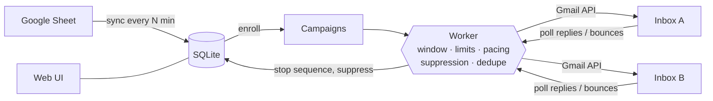

# Outreach Wise

**Minimal, self-hosted cold email outreach. Google Sheets in, Gmail out.**

Outreach Wise — by [Channel Wise](https://github.com/Channel-Wise)

[](https://github.com/Channel-Wise/outreach-wise/actions/workflows/ci.yml)
[](LICENSE)


Outreach Wise syncs leads from a Google Sheet, sends personalized sequences from your own
Gmail / Google Workspace inboxes, stops following up the moment someone replies, and shows you
what's working. It is one Python process and one SQLite file. There's no SaaS subscription and
no per-seat pricing, and your lead data never leaves your server.

It was built for Channel Wise's own outreach to YouTube creators (thousands of leads in a
sheet, a few hundred new ones a day). It has no dependency on Channel Wise infrastructure, and
anyone can self-host it.

## Features

- **Google Sheets sync**: periodic and on demand. Leads are deduplicated by normalized email,
  every column becomes a template variable, and status is tracked per lead
  (new → contacted → replied / bounced / unsubscribed).
- **Gmail & Google Workspace** via the official Gmail API. Connect several inboxes: new leads
  are spread across them, and a lead's follow-ups always come from the same inbox, in the same
  thread.
- **Campaigns** with multi-step sequences, `{{variable|fallback}}` templates and **A/B variants**
  on any step (balanced split, with a significance test on reply rate).
- **Scheduling**: sending windows, sending days, timezone, an optional campaign start time, and
  sends spread evenly across the window.
- **Automatic stops**: replies, bounces and unsubscribes (link, one-click header or "unsubscribe"
  reply) end the sequence and update the suppression list. Out-of-office replies don't stop it.
- **Dashboard**: daily sends, reply rate, per-campaign performance, A/B results, latest replies
  with a link to the Gmail thread.
- **Guardrails**: per-inbox daily limits, a suppression list (emails and whole domains), a full
  activity log and an emergency "pause all sending" switch.
- **Dry run by default.** Every campaign starts as a dry run, and going live requires an explicit
  approval screen.

What it deliberately doesn't do: open or click tracking (it hurts deliverability and privacy),
its own SMTP or delivery infrastructure, multi-user roles, or enterprise features.

## How it works



- **Web UI**: Flask, server-rendered pages, one CSS file, no JavaScript build.
- **Worker**: a background thread in the same process (or a separate `outreach-wise worker`).
  A lease lock in the database ensures only one worker ever runs, even if you start several
  processes.
- **Storage**: SQLite in WAL mode with plain SQL and no ORM. Back up a single file.
- **Google APIs**: plain HTTPS calls to Gmail and Sheets, without heavyweight SDKs.

## Quick start

### With Docker

```bash
git clone https://github.com/Channel-Wise/outreach-wise.git
cd outreach-wise
cp .env.example .env
```

Set `SECRET_KEY` and `ADMIN_PASSWORD` in `.env` (see below), then:

```bash
docker compose up -d
```

Open <http://localhost:8000> and sign in with `ADMIN_PASSWORD`.

### With Python (3.11+)

```bash
git clone https://github.com/Channel-Wise/outreach-wise.git
cd outreach-wise
cp .env.example .env
```

Set `SECRET_KEY` and `ADMIN_PASSWORD` in `.env`, then install and run with
[uv](https://docs.astral.sh/uv/) (or `python -m venv .venv && .venv/bin/pip install -e .`):

```bash
uv sync
uv run outreach-wise serve
```

Generate a secret key with:

```bash
python -c "import secrets; print(secrets.token_urlsafe(48))"
```

### Try it without Google

You can explore the full flow before setting up any Google credentials. This loads 60 fake
leads on `example.com`, which is never deliverable:

```bash
uv run outreach-wise demo
```

Then create a campaign, enroll the leads and start it. In dry-run mode the worker goes through
everything (window, limits, A/B split, follow-up timing) without sending a single email.
Addresses on reserved test domains (`example.com`, `.test`, …) are refused by live sending
anyway.

## Google setup

You need one OAuth client, created once in Google Cloud. It covers Gmail and Sheets for every
inbox you connect.

1. **Create a project** at [console.cloud.google.com](https://console.cloud.google.com/).
2. **Enable APIs**: *APIs & Services → Library* → enable **Gmail API** and **Google Sheets API**.
3. **Configure the OAuth consent screen** (*Google Auth Platform → Branding / Audience*):
   - **Google Workspace (recommended):** choose **Internal**. Only accounts in your organization
     can connect, and no Google verification is needed.
   - **Personal Gmail:** choose **External**, keep it in **Testing**, and add the inboxes you'll
     connect as *test users*. In Testing mode Google expires refresh tokens after **7 days**, so
     you'll need to reconnect weekly. Publishing an External app with Gmail scopes requires
     Google's verification process.
4. **Create credentials**: *Clients → Create client → Web application*.
   Add the authorized redirect URI `<BASE_URL>/oauth/callback`, for example
   `http://localhost:8000/oauth/callback`.
5. Put the client ID and secret in `.env` as `GOOGLE_CLIENT_ID` / `GOOGLE_CLIENT_SECRET` and
   restart.
6. In the app: **Settings → Inboxes → Connect Google account**. Approve all permissions.

| Scope | Why |
|---|---|
| `gmail.send` | Send emails as the connected inbox |
| `gmail.readonly` | Detect replies, bounces and unsubscribes; thread follow-ups correctly |
| `spreadsheets.readonly` | Read your lead sheet (never written to) |

Refresh tokens are encrypted at rest with a key derived from `SECRET_KEY`.

## Your lead sheet

- The **first row is the header**. One column holds the email address (`email` by default;
  configurable, and common names like `Email Address` are detected).
- **Every column becomes a template variable**, with names normalized: `First Name` →
  `{{first_name}}`, `Channel URL` → `{{channel_url}}`.
- Emails are trimmed and lowercased. Invalid rows and duplicates are skipped and counted.
- The sheet owns lead *data*; Outreach Wise owns lead *status*. Re-syncing updates fields but
  never resets a lead who already replied or unsubscribed, and rows deleted from the sheet are
  kept.
- The sheet is read with the **first connected inbox's** Google account, so share the sheet
  with that account (Viewer access is enough).

Configure the sheet URL, tab name, email column and sync interval in **Settings → Lead source**.

## Writing campaigns

```
Subject: Quick question about {{channel_name|your channel}}

Hi {{first_name|there}},

I watched {{latest_video|your latest video}} and ...
```

- `{{variable}}` inserts a column value; `{{variable|fallback}}` uses the fallback when it's empty.
- A lead missing a variable that has **no** fallback is **skipped**, so nobody ever gets
  "Hi {{first_name}}". The preview page tells you how many leads that affects before you go
  live.
- **Follow-ups** with an empty subject are sent as replies in the same Gmail thread
  ("Re: …"). Each step waits *N days* after the previous email, and only if there's no reply.
- **A/B testing**: add variants to any step. Leads are split evenly between active variants,
  and replies are attributed to the last email sent before them. Results show a winner once a
  two-proportion z-test reaches 95% confidence, with at least 30 sends per variant.
- Emails are **plain text**. Your footer (Settings → Sender & footer) is appended to every
  email. Available system variables: `{{email}}`, `{{unsubscribe_url}}`.
- **Auto-enroll** puts new leads from each sheet sync straight into an active campaign.

## Safety model

Sending email to real people is irreversible, so the defaults are conservative:

| Guard | What it does |
|---|---|
| **Dry run first** | New campaigns run the full pipeline without calling Gmail. |
| **Explicit approval** | Going live requires reviewing rendered emails, ticking a box and typing the campaign name. The approval is logged. Dry-run history is discarded and the sequence restarts for real. |
| **No duplicate sends** | Each step is claimed in the database (`UNIQUE(enrollment, step)`) and committed *before* Gmail is called. One worker at a time (lease lock). |
| **Unknown ≠ retry** | If Gmail's response is lost (timeout, crash mid-send), the message is marked `unknown` and that lead's sequence stops for you to check. It is never resent blindly. Temporary errors that Google reports explicitly (rate limits, outages) are retried up to 3 times; permanent ones stop that lead. |
| **Reply check before every follow-up** | Besides polling inboxes every few minutes, the thread is re-checked right before each follow-up goes out. |
| **Limits & pacing** | Per-inbox daily limits, sending window and days, sends spread evenly with jitter, and a minimum gap between sends. |
| **Suppression** | Checked at send time, not just at enrollment. Bounces and unsubscribes are added automatically. Whole domains can be blocked. |
| **Kill switch** | "Pause all sending" stops every campaign instantly. |
| **Bad credentials** | An inbox whose token stops working is paused and flagged, and its sends wait until you reconnect. |

## Configuration

Deployment settings come from environment variables (or `.env`); everything else is edited in
the UI.

| Variable | Default | Description |
|---|---|---|
| `SECRET_KEY` | — (required) | ≥ 32 random characters. Encrypts tokens, signs sessions and unsubscribe links. |
| `ADMIN_PASSWORD` | — (required) | Web UI password (single admin). |
| `GOOGLE_CLIENT_ID` / `GOOGLE_CLIENT_SECRET` | — | OAuth client from Google Cloud. |
| `BASE_URL` | `http://localhost:8000` | Public URL. Used for the OAuth redirect and unsubscribe links. |
| `HOST` / `PORT` | `127.0.0.1` / `8000` | Listen address. |
| `DATABASE_PATH` | `data/outreach-wise.db` | SQLite file. |
| `RUN_WORKER` | `true` | Run the worker inside the web process. |
| `WORKER_TICK_SECONDS` | `15` | How often the worker wakes up. |

**Unsubscribe links:** every email carries a `List-Unsubscribe` header, so Gmail shows its
native "Unsubscribe" button. When `BASE_URL` is a public `https://` address, a one-click link
(RFC 8058) and `{{unsubscribe_url}}` also work for recipients. Otherwise opt-outs work through
the mailto header and "unsubscribe" replies, which the default footer asks for.

## Deployment

- **Docker**: `docker compose up -d` stores data in the `outreach-data` volume. Put a reverse
  proxy in front for HTTPS. With [Caddy](https://caddyserver.com/), for example:

  ```
  outreach.example.com {
      reverse_proxy 127.0.0.1:8000
  }
  ```

- **Backups**: the SQLite file is all your data. Make a consistent copy while running:

  ```bash
  docker compose exec outreach-wise python -c "import sqlite3; s=sqlite3.connect('/data/outreach-wise.db'); s.backup(sqlite3.connect('/data/backup.db'))"
  ```

- **Separate worker**: set `RUN_WORKER=false` on the web process and run
  `outreach-wise worker` alongside it.
- **Upgrades**: pull and restart. Database migrations run automatically on start.

## Deliverability & compliance

Outreach Wise sends through your real inboxes, so your domain's reputation is on the line:

- Set up **SPF, DKIM and DMARC** on your sending domain (Google Workspace Admin → Gmail →
  Authenticate email).
- Warm up new inboxes. Start at **20–40 emails per day per inbox** and increase slowly. Google's
  hard caps (around 500/day for Gmail, 2,000/day for Workspace) are far above what's safe for
  cold email. To reach more people, add inboxes rather than raising limits.
- Keep emails short and relevant, in plain text, with few links.
- You are responsible for complying with the laws that apply to you (for example CAN-SPAM, GDPR,
  CASL). The footer is the place for your postal address and an opt-out line.

## Development

`uv sync` installs the dev dependencies too. Tests use a fake Google client, so nothing is
ever sent:

```bash
uv sync
uv run pytest
uv run ruff check . && uv run ruff format --check .
```

```
outreach_wise/
  config.py      environment configuration
  db.py          SQLite schema & migrations, settings, activity log, lease lock
  google.py      OAuth, Gmail and Sheets over HTTPS
  sheets.py      sheet parsing, normalization, dedupe, upsert
  campaigns.py   sequences, variants, enrollment, stats, A/B, preview, go-live
  sender.py      the send cycle: windows, limits, pacing, claiming, MIME, recovery
  inbox.py       reply / bounce / unsubscribe detection
  worker.py      background loop
  web.py         Flask routes
  templates/     Jinja templates
  static/        style.css
```

See [CONTRIBUTING.md](CONTRIBUTING.md). Contributions that keep the tool small and reliable are
very welcome.

## Roadmap

Ideas that fit the "minimal" scope, not yet built:

- Write lead status back to the Google Sheet
- CSV import as an alternative lead source
- Per-campaign sending windows and inbox selection
- Reply sentiment labels (interested / not interested)

## Security

Please report vulnerabilities privately; see [SECURITY.md](SECURITY.md).

## License

[MIT](LICENSE) © Channel Wise
